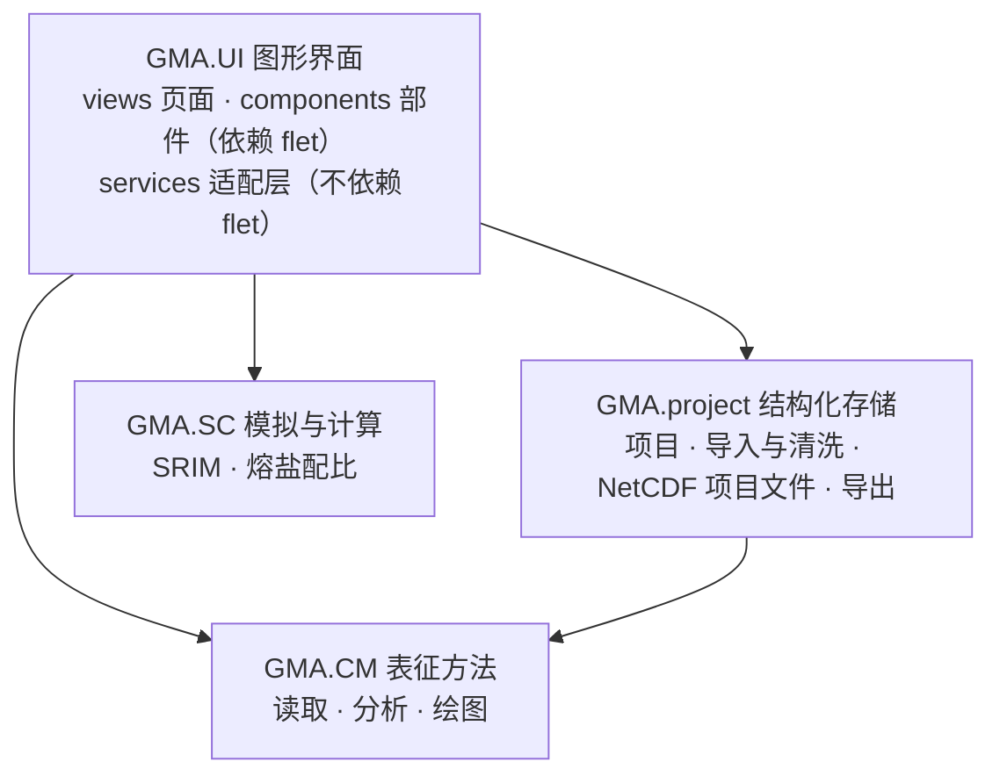

# OpenGMA 开发者手册

这份手册写给想修改或扩展 OpenGMA 的人：接入新的仪器、增加表征方法或计算工具、改图形界面，或者打包发布。只是使用 OpenGMA 的话，看仓库首页的 [README](../../README.md) 就够了。

## 章节

| 章节 | 内容 |
| --- | --- |
| [设计哲学](设计哲学.md) | 为什么这样设计：从原始数据到科学结论的流水线 |
| [开发流程](开发流程.md) | 开发环境、运行与测试、代码约定、分支与 PR、打包与 GitHub Actions |
| [CM 模块](CM模块.md) | 表征方法：标准数据结构、Loader / Analyzer / Plotter、接入新的仪器、增加表征方法 |
| [project 模块](project模块.md) | 结构化存储：项目、样品、谱图，NetCDF 项目文件，导入与清洗，导出 |
| [SC 模块](SC模块.md) | 模拟与计算：SRIM 的 dpa 和注入离子浓度、熔盐配比，增加计算工具 |
| [UI 模块](UI模块.md) | 图形界面：架构、模块注册表、页面与组件、界面文字和翻译、自动备份与项目锁 |

## 整体结构

箭头表示“调用”。依赖只朝一个方向：核心库（CM、SC）和 project 不导入 flet，界面依赖它们，反过来不行。所以 GMA 可以在 marimo、Jupyter 或脚本中当作库使用，界面能做的事情在库中都有对应的函数；界面中的“复制为代码”生成的就是这些调用。

## 常见任务

| 想做的事 | 从哪里看起 |
| --- | --- |
| 读取一台新仪器导出的文件 | [CM 模块 · 接入新的仪器](CM模块.md#接入新的仪器) |
| 增加一种表征方法（如 FTIR） | [CM 模块 · 增加表征方法](CM模块.md#增加表征方法)，再看 [project](project模块.md#增加表征方法) 和 [UI](UI模块.md#增加一个表征方法模块) 中对应的小节 |
| 增加一个计算工具 | [SC 模块 · 增加计算](SC模块.md#增加计算)，界面见 [UI 模块](UI模块.md#增加一个计算工具) |
| 修改或增加界面文字、翻译 | [UI 模块 · 界面文字与翻译](UI模块.md#界面文字与翻译) |
| 运行测试、提交代码 | [开发流程](开发流程.md) |
| 打包成不需要 Python 的程序 | [开发流程 · 打包](开发流程.md#打包) |

## 设计方案中的约定

图形界面按《OpenGMA 图形界面设计方案（第三版）》分阶段开发（P0 技术验证、P1 核心层、P2 界面框架、P3 XPS、P4 Raman 与 XRD、P5 计算工具等第二期内容）。代码注释中的“方案 x.y”指这份方案中的章节，“Qn”指其中的决定。方案不在仓库中，下面是代码中常引用的部分。

**设计原则**

1. 三个系统通用：Windows、macOS、Linux 用同一套界面和操作方式，不写按系统区分的分支；遇到系统差异时，选三个系统都能工作的做法。
2. 数据优先于界面状态：内存中的项目对象是唯一的事实来源，界面只是它的视图；改名、删除等操作先改项目，再刷新界面。
3. 忠实保存，显式解释：读取时只做列名标准化、数值转换和去除无效行，并写进清洗记录；归一化、错开、缩放都只影响显示，不修改保存的数据。
4. 依赖单向：GMA 核心不导入 flet。
5. 交互查看与出版输出各司其职：交互图用于查看和读数，出版图用于导出，两者用同一份数据和同一个分峰数据模式。
6. 通用，不预设：不内置峰位、化学键、物相等领域知识，只显示数据本身带有的或用户自己填写的信息；拿不准的分析结果不显示。
7. 渐进呈现复杂度：默认先看到谱图，参数放在可以收起的侧栏里。
8. 错误可理解：提示“哪个文件、哪一步、为什么”，而不是 Python 的报错堆栈。

**决定**

| 编号 | 问题 | 决定 |
| --- | --- | --- |
| Q1 | 扣背景与峰拟合 | 不做；作为后处理软件，分析只用标准数据结构中已有的列 |
| Q2 | 存储格式 | NetCDF；另提供 CSV、Excel 数据导出 |
| Q3 | 进入工作区的方式 | 同一进程换窗 |
| Q4 | 关闭工作区 | 默认回到启动器，设置中可改为直接退出 |
| Q5 | 图区 | Flet 原生 LineChart 为主，出版图显示生成的图片 |
| Q6 | 复制为 Python 代码 | 加入 |
| Q7 | 预设内容 | 不预设；提供用户设定的选项，没设定的不显示 |
| Q8 | 项目文件的层级 | /样品/方法/谱图 |
| Q9 | 扩展名 | .nc |
| Q10 | 保存界面状态 | 是 |
| Q11 | OpenXPSAnalyzer 旧项目 | 不导入，可以参考和使用其代码 |
| Q12 | 主色 | 延续青蓝，并可选择或自定义主题色 |
| Q13 | 界面语言 | 先中文，文字集中管理（第二期加了英文） |
| Q14 | 图标 | 按表征方法设计 |
| Q15 | 交付方式 | 分支 + PR，由作者决定是否合并 |
| Q16 | 组图 | 不做 |
| Q17 | 计算工具入口 | 在注册表中登记（第二期已实现） |
| Q18 | 项目总览 | 作为工作区第一个固定标签：样品表、数据检查、数据导出 |
| Q19 | 数据清洗的范围 | 只做不改变科学含义的整理，截取等操作生成派生数据 |
| Q20 | Excel 导出 | 每条谱图一个工作表，另附“信息”表 |
| Q21 | 规划中的模块 | 在启动器中显示为灰色，标“规划中” |
