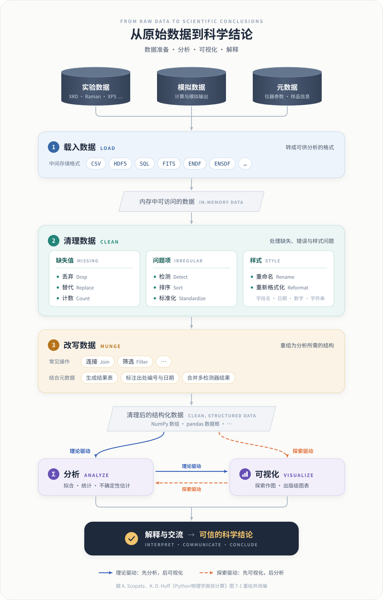

# OpenGMA 的设计哲学
OpenGMA 的设计受到安东尼·斯科普斯（Anthony Scopatz）与凯瑟琳·赫夫（Kathryn D. Huff）合著的《Python物理学高效计算》的启发。正如书中所说，通过模拟和实验获取的原始数据本身并不直接具备科学意义：只有经过深入的分析与可视化，这些数据才能转化为具有科学价值的信息。未经处理的数据只是杂乱的数字集合，唯有经过合理的解释与有效的交流，其中蕴含的科学内涵才会显现；最终，经过严谨分析与可视化的真实数据，才能升华为可信的科学结论。

我们还参考了一些表征相关的书籍，并由此认识到：表征同样是借助某种媒介（例如电子、光子）获取物质某些方面的信息，而这些信息通常又被转化为数据。于是，对物质的研究可以归结为几个问题：如何获取这些信息，如何用数据表达这些信息，如何处理和分析数据，以及如何把这些信息解释（“翻译”）为我们感兴趣的物理结论。

> **物质** →（电子、光子等探针）→ **信号** → **数据** → **处理与分析** → **解释** → **物理结论**

正是基于这种思想，并借助 Python 在物理学计算中的应用，我们尝试开发了 OpenGMA。

## 从原始数据到科学结论

书中第 7 章“分析和可视化”把这一过程概括为一条数据流水线（图 1）：实验数据、模拟数据和元数据先被**载入**并转换为统一的格式，再经过**清理**与**改写**，成为干净的结构化数据，然后才进入**分析**与**可视化**。我们在原图的基础上补上了最后一环——**解释与交流**，因为只有经过解释的结果，才能成为科学结论。

  

图 1　从原始数据到科学结论。据 Scopatz 与 Huff《Python物理学高效计算》图 7-1 重绘并改编。

### 载入：转成可供分析的格式

原始数据来源五花八门、格式各异。第一步是把它们转换为通用的中间存储格式，例如 CSV、HDF5、SQL 数据库，或领域专用格式——天文学的 FITS、核数据领域的 ENDF 与 ENSDF（两位作者都是核工程出身）；再读入内存，变成便于访问的数据结构，如 NumPy 数组和 pandas 数据框。

### 清理：让数据值得信任

| 需要处理的问题 | 常见做法 |
| --- | --- |
| 缺失值 | 丢弃部分数据；用默认值替代；至少统计缺失的数量 |
| 有问题的数据项 | 检测错误；为无序数据排序；统一数据格式 |
| 样式问题 | 重命名过长或无关的字段；统一日期、时间、数字、字符串的写法 |

### 改写：重组为分析所需的结构

清理之后，还要通过连接（join）、筛选（filter）等操作，把数据重组为分析所需的形态。其中最重要的一类连接，是把数据与元数据结合起来：依据附加信息生成结果表，添加编号和日期以标明出处，合并来自不同检测器的结果。对表征数据来说，典型的例子是按样品编号，把 XRD、Raman、XPS 的结果与制备工艺、处理条件等样品信息关联起来。

### 分析与可视化：理论驱动与探索驱动

得到干净的结构化数据后，有两种进入方式，而且两者往往交替进行：

- **理论驱动——先分析，后可视化**：从模型或假设出发，先计算，再作图检验和呈现。例如物相已知时，直接拟合 XRD 衍射峰求晶粒尺寸，再把拟合结果画出来核对。
- **探索驱动——先可视化，后分析**：先作图观察，发现趋势或异常，再有针对性地定量分析。例如先把一组 Raman 光谱叠放比较，注意到部分样品多出了特征峰，再对这些峰做分峰拟合。

两者并无高下之分：探索中发现的现象需要分析来量化，分析得到的结果又需要可视化来检验和交流。

## 自动化与可重复性

### 把重复劳动交给脚本

作者注意到，许多研究者把大量时间花在手工清理数据、逐个执行分析步骤、用鼠标绘制图表上；每当有新数据或需要调整处理方式，所有步骤又得重来一遍。更聪明的做法是把处理流程写成脚本。这在起步时需要多投入一些精力，但回报是持续的：面对新数据时能更快完成分析，可以方便地尝试新的分析步骤、调整图表，并把省下的时间用于验证结果、开展更多研究。

按书中的总结，一条完整的处理流程至少包括：

> 数据获取 → 数据清理 → 构建所需软件 → 运行模拟与分析 → 数据后处理 → 不确定性估计 → 生成用于发表的图表 → 撰写论文

### 可重复性比投入产出比更重要

作者半开玩笑地指出：只有在数据非常简单、审稿人又不太较真的情况下，手工处理数据的人发表论文的速度才可能赶上实现了自动化的人，而指望这种侥幸并不现实。更重要的是，如果真正重视科学计算的可重复性，就不应再计较投入产出比，而应把流程完全自动化。尽管现行的科研激励机制并不鼓励可重复性，但这一点正在改变——作者甚至借用了 Mario Savio 1964 年在伯克利“言论自由运动”中的著名演讲，戏谑地号召读者站到“历史正确的一边”。

自动化的第一步，是自动处理原始数据。实验数据与模拟数据的处理步骤各不相同，并且各自带有相应的元数据。

## OpenGMA 的设计原则

基于上述思想，OpenGMA 在设计上力求做到：

1. **统一入口**：把不同仪器、不同软件导出的数据读入一致的内存结构（NumPy 数组、pandas 数据框），让后续处理不再依赖具体的文件格式。
2. **数据与元数据同行**：仪器参数、测试条件和样品信息随数据一起保存、一起传递，使每个结果都能追溯来源。
3. **流程即代码**：扣除背景、平滑、归一化、拟合等每一步都以代码和显式参数记录下来，取代鼠标操作，使处理过程可以重复、检查和复用。
4. **分析与可视化并重**：既支持基于模型的定量分析，也支持快速作图与对比浏览，方便在理论驱动与探索驱动之间切换。
5. **面向发表的输出**：直接生成符合出版要求的图表，把“画图”从手工劳动变成流程中的一步。
6. **开放、可检验**：开源，并基于 Python 科学计算生态，便于他人检验、复用和扩展。

## 参考文献

1. 安东尼·斯科普斯, 凯瑟琳·赫夫. Python物理学高效计算[M]. 北京: 人民邮电出版社, 2018.
2. SCOPATZ A, HUFF K D. Effective computation in physics: field guide to research with Python[M]. Sebastopol, CA: O'Reilly Media, 2015.